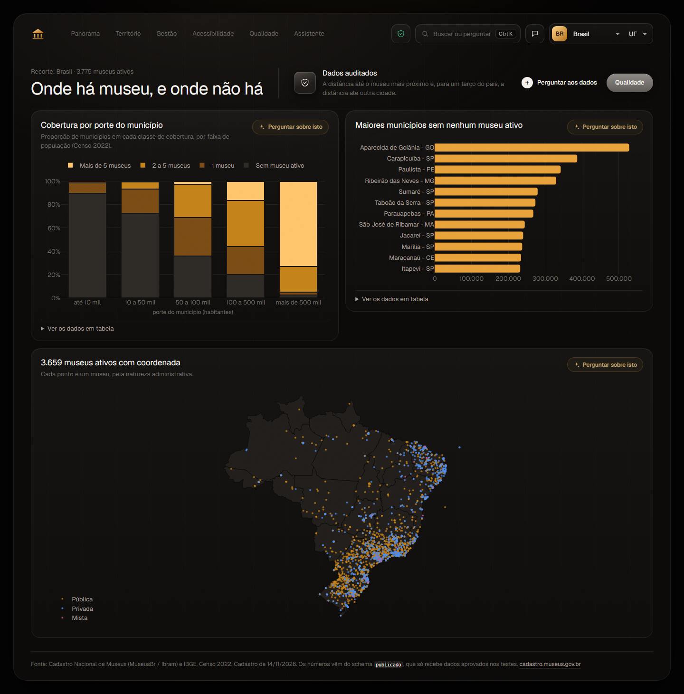
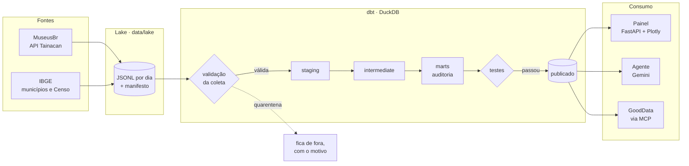
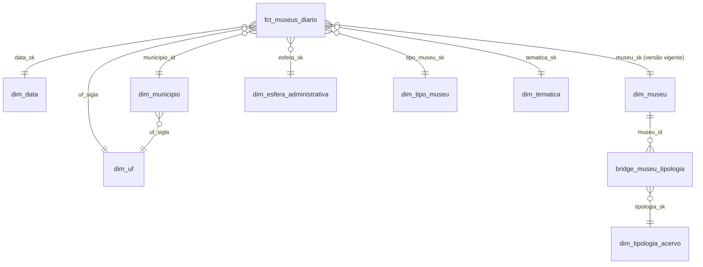
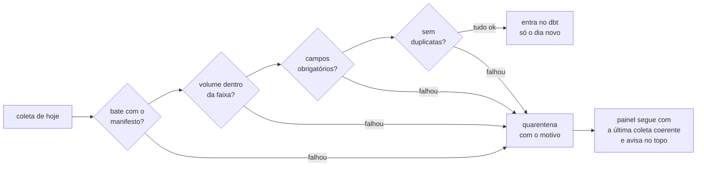
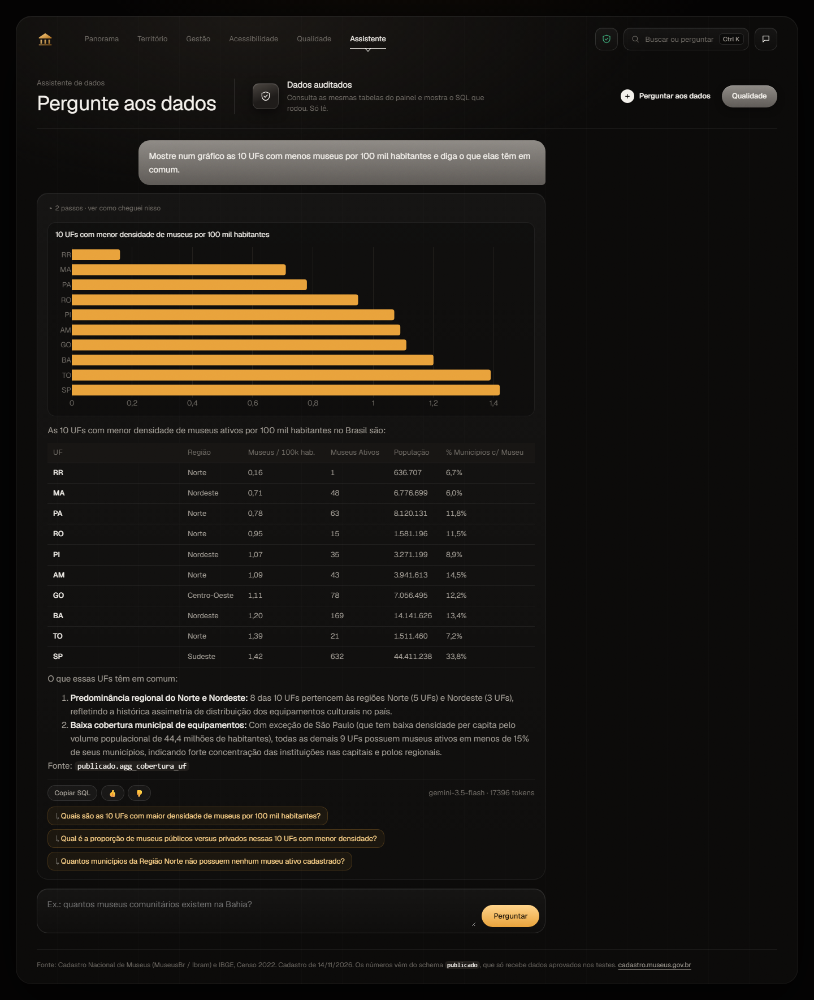
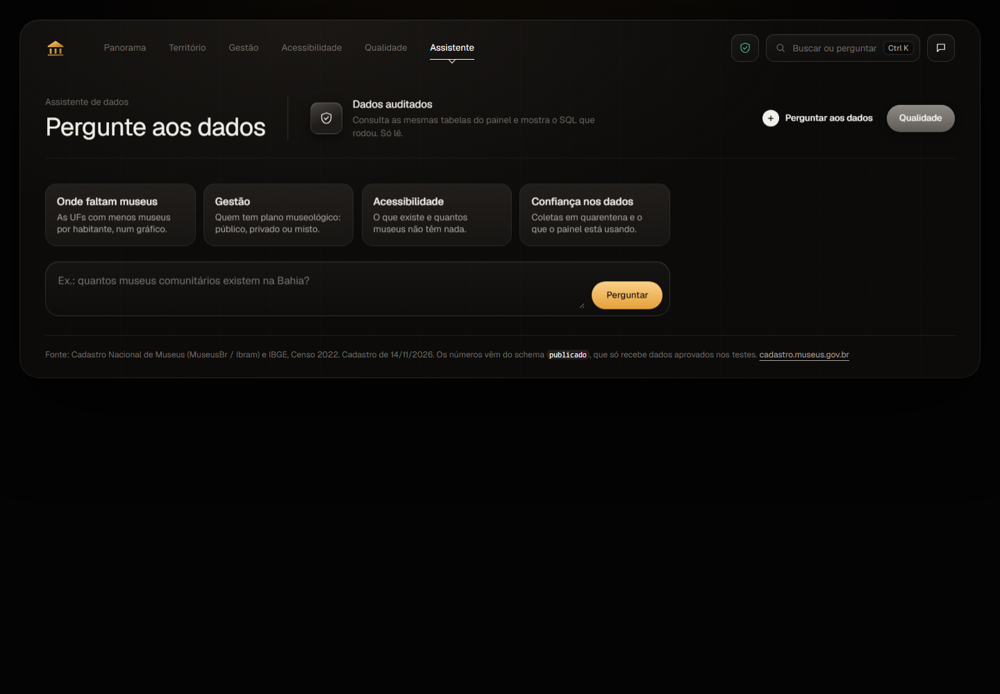
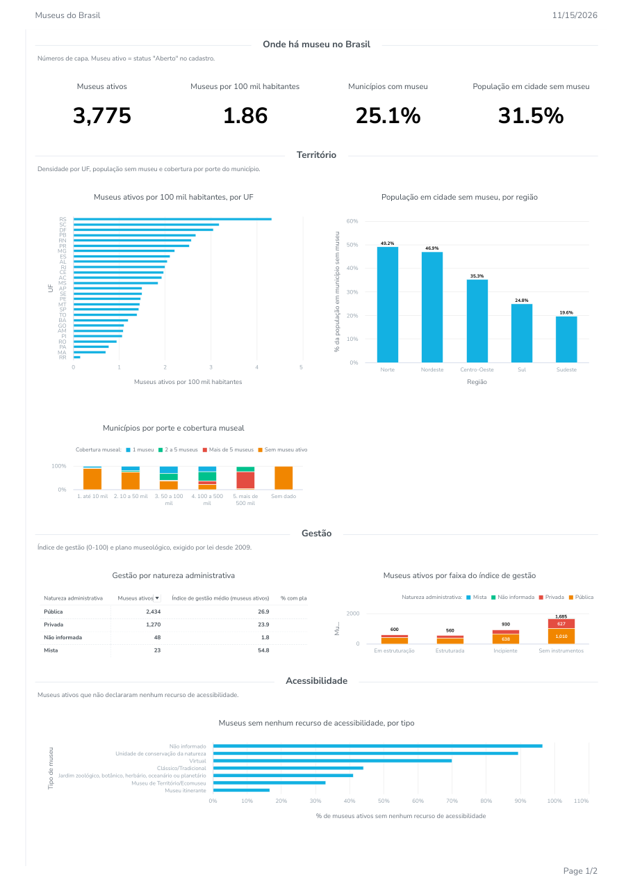

<div align="center">

# Museus do Brasil

**Onde há museu no Brasil, onde não há, e como eles estão organizados.**

Lake particionado → dbt com Write-Audit-Publish e quarentena → painel em Python → agente de IA → GoodData.
Dados reais do Cadastro Nacional de Museus (Ibram) cruzados com o Censo 2022.


<br>


</div>

---

## Em um minuto

| | |
|:---|:---|
| **A pergunta** | Quantos brasileiros moram longe de qualquer museu, e como os museus que existem se organizam? |
| **Os dados** | 4.159 museus e 536 Pontos de Memória do Ibram (API pública), 5.571 municípios e a população do Censo 2022 (IBGE). |
| **A resposta** | **3.775 museus ativos**, mas em só **25% dos municípios**. **64 milhões de pessoas (31,5%)** vivem em cidade sem museu; no Maranhão, 71%. |
| **O que tem aqui** | Pipeline completo de Analytics Engineering, com qualidade de dados que barra o que está errado, um painel, um agente que responde em português e o mesmo modelo no GoodData. |

<table>
<tr>
<td align="center"><b>3.775</b><br><sub>museus ativos</sub></td>
<td align="center"><b>1,86</b><br><sub>por 100 mil habitantes</sub></td>
<td align="center"><b>25%</b><br><sub>dos municípios têm museu</sub></td>
<td align="center"><b>31,5%</b><br><sub>da população sem museu na cidade</sub></td>
<td align="center"><b>24%</b><br><sub>têm plano museológico</sub></td>
<td align="center"><b>50%</b><br><sub>sem nenhum recurso de acessibilidade</sub></td>
</tr>
</table>

### Índice

[Tour visual](#tour-visual) · [Como funciona](#como-funciona) · [Modelagem](#modelagem) · [Qualidade e quarentena](#qualidade-e-quarentena) · [Agente](#agente-de-ia) · [GoodData](#gooddata) · [Rodar](#rodar-em-3-passos) · [Publicar](#publicar-render) · [Estrutura](#estrutura) · [Decisões](#decisões)

---

## Tour visual

<table>
<tr>
<td width="50%"><br><b>Território.</b> Cobertura por porte de município, maiores cidades sem museu e os 3.659 museus com coordenada.</td>
<td width="50%"><br><b>Gestão.</b> Quem tem plano museológico, regimento, política de acervo, por natureza administrativa.</td>
</tr>
<tr>
<td><br><b>Acessibilidade.</b> Quantas dimensões cada museu atende e quais recursos existem.</td>
<td><br><b>Qualidade.</b> Saúde de cada coleta, etapas do pipeline, preenchimento por UF e todos os testes.</td>
</tr>
<tr>
<td><br><b>Filtros.</b> Região e UF na URL (<code>/?regiao=NE</code>). Clique numa UF no mapa e o painel inteiro filtra.</td>
<td><br><b>Ctrl + K.</b> Digite uma UF, uma página ou uma pergunta em português.</td>
</tr>
</table>

**O que torna o painel diferente**

| | |
|---|---|
| **IA no contexto** | Todo gráfico tem *Perguntar sobre isto*: o assistente abre ao lado já sabendo qual gráfico e qual recorte você está vendo. |
| **Movimento com propósito** | Os blocos entram em sequência, os números contam até o valor, as barras crescem, a troca de página tem transição suave. Tudo desliga com `prefers-reduced-motion`. |
| **Acessível** | Paleta validada para daltonismo, uma tabela com os mesmos números em cada gráfico, navegação por teclado (`←` `→` trocam de região). |
| **Sem estado no servidor** | FastAPI monta as figuras Plotly; o navegador só desenha. Roda na Vercel. |

---

## Como funciona



| etapa | pasta | o que faz |
|---|---|---|
| 1. Coleta | [`ingestao/`](ingestao) | Baixa a API do Ibram e do IBGE com retry e paginação paralela; grava um arquivo por dia com manifesto (contagem, hash). |
| 2. Transformação | [`dbt/`](dbt) | 35 modelos em 3 camadas: esquema estrela, SCD2 incremental, One Big Table com STRUCT/ARRAY, semantic layer. |
| 3. Qualidade | [`dbt/macros/`](dbt/macros) | Valida cada coleta, roda 112 testes e só publica o que passou (Write-Audit-Publish). |
| 4. Orquestração | [`orquestracao/`](orquestracao) | Um comando roda tudo e diz se publicou, se bloqueou ou se isolou uma coleta ruim. |
| 5. Consumo | [`painel/`](painel) · [`agente/`](agente) · [`gooddata/`](gooddata) | Painel, assistente de IA e GoodData leem a mesma camada publicada, com as mesmas métricas. |

---

## Modelagem



| modelo | o que é | por que importa |
|---|---|---|
| `fct_museus_diario` | um registro por museu por dia | **incremental por partição**: reprocessa só os dias novos (`delete+insert` no DuckDB, `insert_overwrite` particionado e clusterizado no BigQuery) |
| `dim_museu` | histórico de cada museu (SCD2) | **incremental**: compara os dias novos com ~4 mil versões abertas; não relê o histórico |
| `bridge_museu_tipologia` | museu × tipologia de acervo | `peso = 1/n` para cada museu contar uma vez só |
| `obt_museus` | One Big Table, um museu por linha | grupos aninhados em STRUCT e listas em ARRAY; é a tabela preferida do agente |
| `agg_*` | indicadores prontos por país, UF e município | razões calculadas **uma vez**; ninguém tira média de razão |

Definição de cada métrica: [docs/metricas.md](docs/metricas.md) · Arquitetura completa: [docs/arquitetura.md](docs/arquitetura.md)

---

## Qualidade e quarentena


**Se a coleta de amanhã vier quebrada, o painel continua certo.** Cada dia coletado é validado antes de entrar:



| situação | o que acontece |
|---|---|
| Coleta quebrada (metade dos museus, campos vazios) | O dia vai para **quarentena** com o motivo por extenso. Os marts ficam no dia anterior e a publicação acontece normalmente. |
| Regra de negócio quebrada (pesos do índice somando 101) | O **circuit breaker** barra a publicação inteira. O painel fica na última versão aprovada. |
| Tudo certo | Publica. Os 22 marts trocam juntos, numa transação. |

Testado de verdade: uma coleta simulada com metade dos museus e 14% sem UF foi para quarentena com *"volume 2079 fora da faixa (régua 4159); campos obrigatórios vazios (sem UF 14.4%)"*, e o painel continuou mostrando 3.775 museus ativos. O CI repete esse cenário a cada PR.

```bash
python scripts/simular_coleta_ruim.py 2026-11-15          # cria uma coleta quebrada
python -m orquestracao.pipeline --sem-ingestao            # vai para quarentena, publica com a anterior
python scripts/simular_coleta_ruim.py 2026-11-15 --apagar # desfaz
```

---

## Agente de IA

<table>
<tr>
<td width="55%"></td>
<td width="45%" valign="top">

**Pergunte em português.** A resposta chega ao vivo:

1. cada passo aparece enquanto acontece (*Consultando…*, *Desenhando…*);
2. o gráfico é desenhado na conversa, quando faz sentido;
3. o texto cita a fonte e mostra o SQL que rodou;
4. termina com três próximas perguntas clicáveis.

**Acerto medido: 8 de 8 perguntas com o número certo**, 1,5 passo em média (`python -m agente.avaliacao`).

</td>
</tr>
</table>

| | como funciona |
|---|---|
| **Memória de exemplos** | 17 perguntas com SQL conferido. As 3 mais parecidas entram no contexto de cada pergunta, com a armadilha anotada. O CI roda todos os SQL. |
| **Aprende com o uso** | 👍/👎 em cada resposta; `python -m agente.promover_feedback` transforma as aprovadas em exemplos, via PR. |
| **Sabe o que você vê** | O filtro do painel (UF, região) vai como contexto. |
| **Seguro** | Só lê: SQL validado pela árvore sintática (só SELECT, só a camada publicada) e conexão sem acesso a arquivo nem rede. |
| **Resiliente** | Se um modelo Gemini estiver sem cota ou lento, passa para o próximo sozinho. |

<details>
<summary><b>Mais telas do agente</b></summary>

| | |
|---|---|
|  |  |
| Temas para começar | Aberto ao lado do painel a partir de um gráfico |

</details>

---

## GoodData

<table>
<tr>
<td width="45%"></td>
<td width="55%" valign="top">

O mesmo modelo publicado no **GoodData Cloud**, montado por código e pelo **servidor MCP do GoodData**:

- dados no armazenamento do próprio GoodData (sem banco externo);
- modelo lógico com Município e Museu ligados;
- 11 métricas MAQL;
- dashboard com 10 visualizações em 4 seções e filtros de região e UF.

**Os números batem com o painel:** 3.775 ativos, 4.159 cadastrados, 25,1% dos municípios com museu, 31,5% da população sem museu.

📄 [Baixar o dashboard em PDF](docs/gooddata-dashboard.pdf)

</td>
</tr>
</table>

```bash
python -m gooddata.provisionar          # dados + modelo lógico + métricas
python -m gooddata.dashboard            # visualizações e dashboard pelo MCP
python -m gooddata.dashboard --validar  # executa cada visualização e mostra os números
python -m gooddata.dashboard --pdf      # exporta o dashboard em PDF para docs/
```

Passo a passo e limitações do trial: [docs/gooddata.md](docs/gooddata.md)

---

## Rodar em 3 passos

```powershell
# 1. ambiente (Python 3.12)
uv venv .venv --python 3.12
uv pip install --python .venv -r requirements-dev.txt
copy .env.example .env        # GEMINI_API_KEY para o agente; GOODDATA_* para o GoodData

# 2. dados: API -> lake -> dbt -> publicado -> serving (~3 min)
.venv\Scripts\python -m orquestracao.pipeline

# 3. painel em http://127.0.0.1:8000
.venv\Scripts\uvicorn painel.app:app --reload
```

| quero | comando |
|---|---|
| rodar sem baixar de novo | `python -m orquestracao.pipeline --sem-ingestao` |
| perguntar pelo terminal | `python -m agente "pergunta" --rastro` |
| testes | `pytest` |
| documentação do dbt | `cd dbt && dbt docs generate --profiles-dir . && dbt docs serve --profiles-dir .` |

O que fazer quando o pipeline para: [docs/runbook.md](docs/runbook.md)

---

## Publicar (Render)

O painel e o agente sobem no **Render** a partir deste repositório, pelo [`render.yaml`](render.yaml):
**New → Blueprint**, escolher o repositório e preencher `GEMINI_API_KEY`. Os dados vão junto, em
`data/serving` (1,3 MB de Parquet), e cada `git push` publica de novo.

Passo a passo e o card pronto para o portfólio: [docs/deploy-render.md](docs/deploy-render.md).
A Vercel também funciona (`vercel.json` + `api/index.py`), mas o Render não tem limite de tamanho de
função e mantém o streaming do agente sem ajuste.

---

## Estrutura

```
ingestao/          coleta Ibram + IBGE -> data/lake
dbt/               35 modelos, macros (WAP, quarentena, cross-db), seeds, testes
orquestracao/      pipeline + exportação para data/serving
consumo/           conexão somente leitura com os dados publicados
painel/            FastAPI + Plotly + templates + efeitos
agente/            Gemini, ferramentas, memória de exemplos, avaliação
gooddata/          modelo lógico, métricas MAQL, dashboard via MCP, PDF
ai_templates/      exemplos canônicos de modelo dbt
api/index.py       entrada da Vercel
docs/              arquitetura, métricas, decisões, runbook, imagens
tests/             pytest + amostra do lake para o CI
```

---

## Decisões

| # | decisão |
|---|---|
| [001](docs/decisoes/001-duckdb-local-bigquery-target.md) | DuckDB local, BigQuery como target preparado (ainda não executado) |
| [002](docs/decisoes/002-lake-com-payload-simplificado.md) | Lake guarda o item simplificado: 45 KB → 0,6 KB por museu |
| [003](docs/decisoes/003-scd2-a-partir-das-particoes.md) | SCD2 a partir das partições, sem `dbt snapshot` |
| [004](docs/decisoes/004-wap-com-circuit-breaker-duplo.md) | Write-Audit-Publish com circuit breaker em dois pontos |
| [005](docs/decisoes/005-orquestracao-por-script.md) | Script em vez de Airflow, e quando isso deixa de valer |
| [006](docs/decisoes/006-agente-sql-guardado.md) | Agente com SQL validado e conexão somente leitura |
| [007](docs/decisoes/007-painel-fastapi-plotly.md) | FastAPI + Plotly em vez de Streamlit (Vercel) |
| [008](docs/decisoes/008-ldm-gooddata-em-codigo.md) | Modelo lógico do GoodData em código |
| [009](docs/decisoes/009-quarentena-por-particao.md) | Quarentena por coleta e processamento só do que é novo |
| [010](docs/decisoes/010-agente-com-memoria-e-avaliacao.md) | Agente com memória de exemplos, streaming e avaliação |

---

## Limitações

- O cadastro é declaratório: "município sem museu" quer dizer "sem museu no cadastro do Ibram".
- Só existe uma coleta real até agora (14/11/2026); o histórico do SCD2 começa aí. O CI usa uma amostra com três dias para exercitar mudança, remoção e quarentena.
- O target BigQuery tem as macros e configurações, mas não foi executado (ver [ADR 001](docs/decisoes/001-duckdb-local-bigquery-target.md)).
- Pontos de Memória têm UF mas não município, então entram só na análise por UF.

## Fontes

- **Cadastro Nacional de Museus** (Ibram): [cadastro.museus.gov.br](https://cadastro.museus.gov.br). Listado na [Base dos Dados](https://basedosdados.org/dataset/ca9fb491-314f-433e-b8e8-f1db27235442) como "Museus.br", ainda sem tabela tratada.
- **IBGE**: [API de Localidades](https://servicodados.ibge.gov.br/api/docs/localidades), [SIDRA tabela 4709](https://sidra.ibge.gov.br/tabela/4709) e [API de Malhas](https://servicodados.ibge.gov.br/api/docs/malhas).
