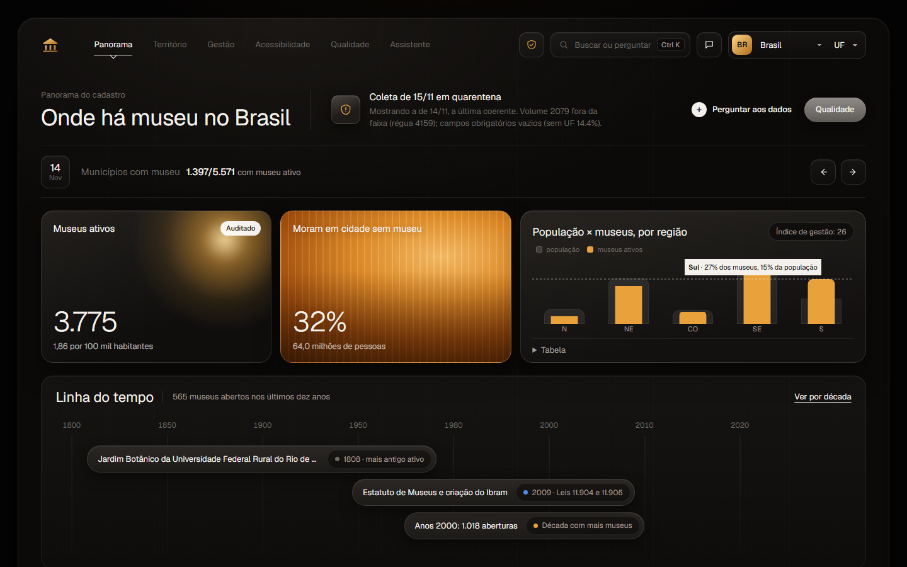
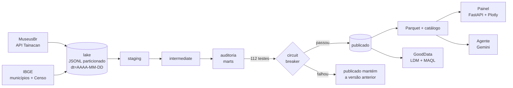
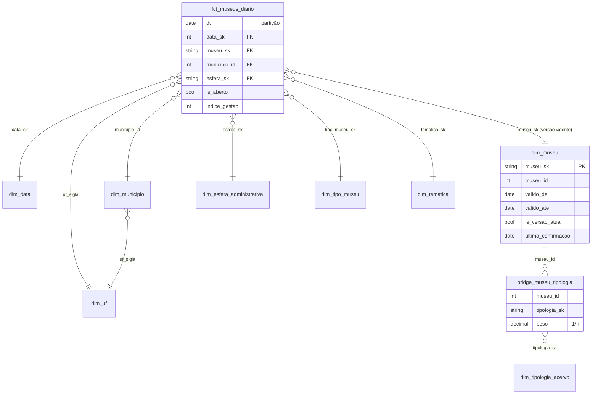
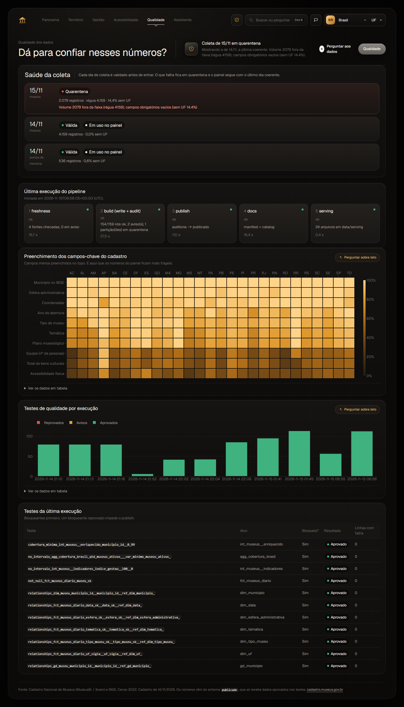
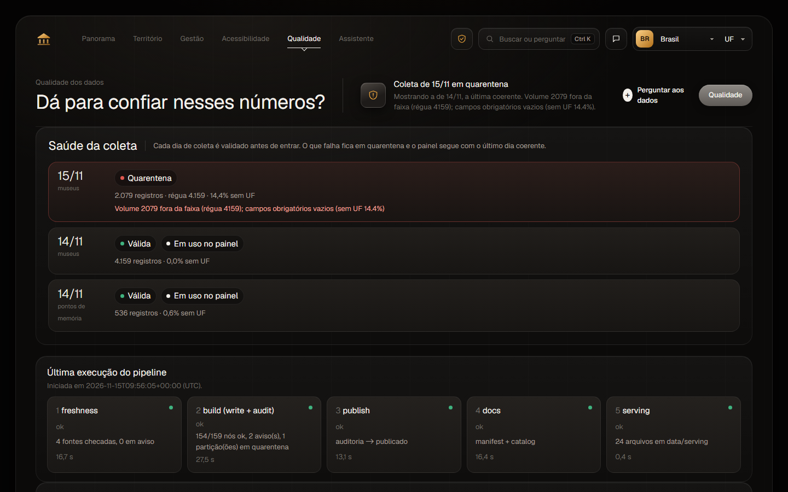
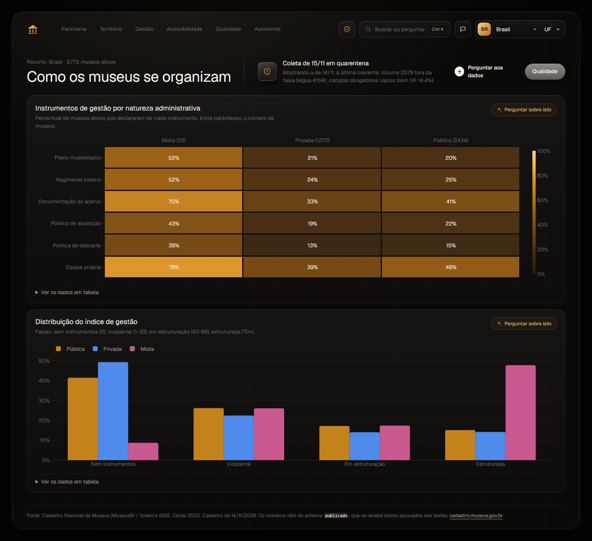
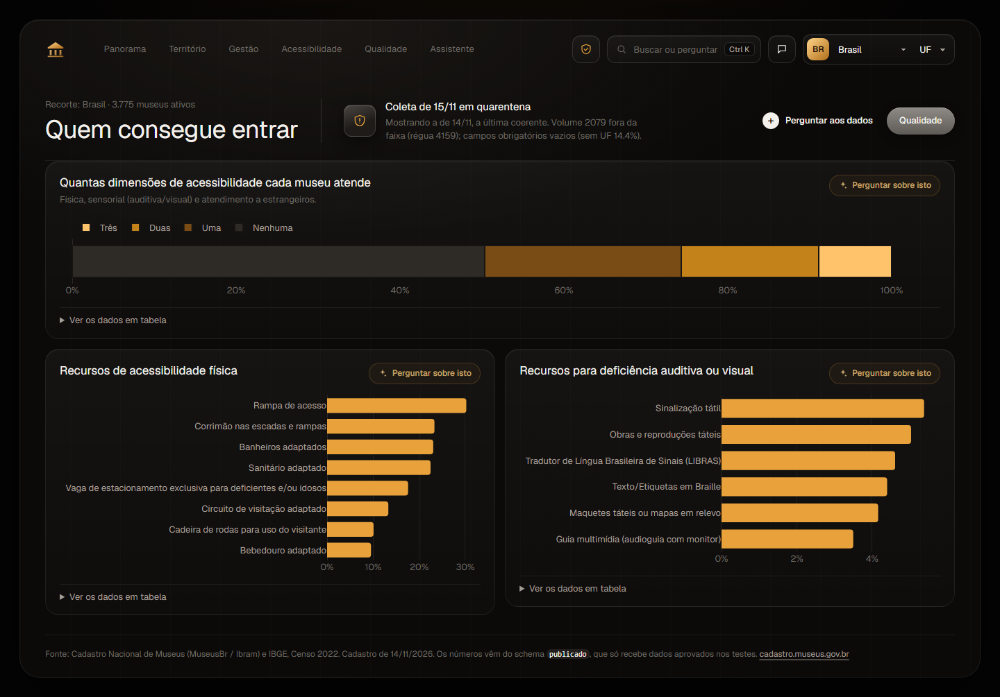
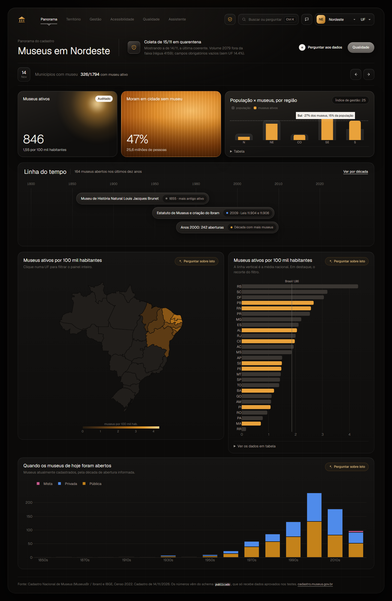
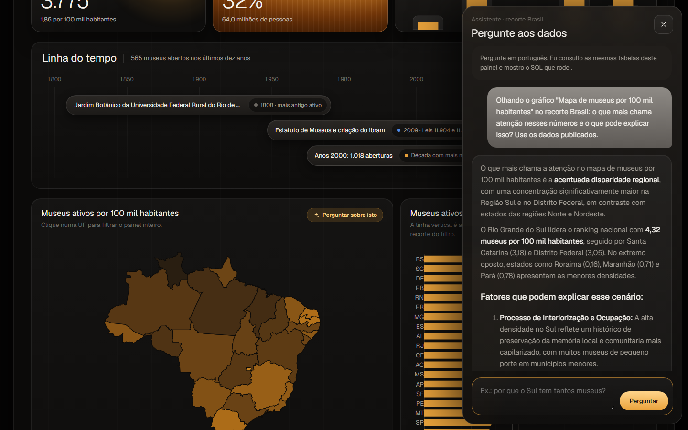
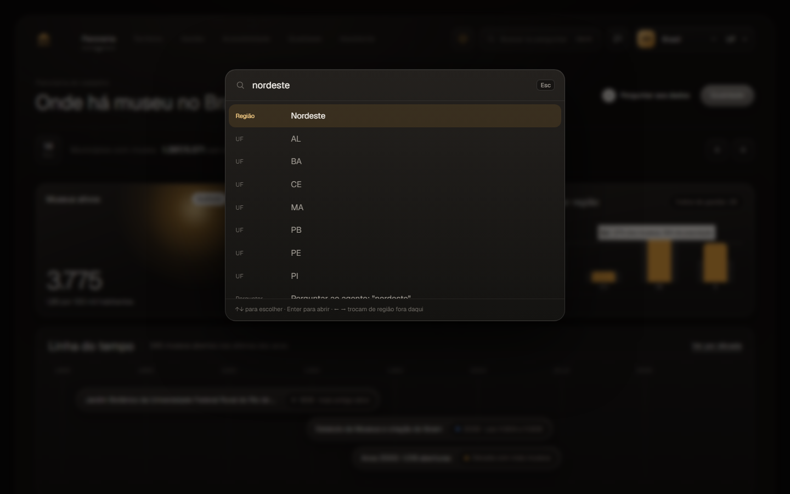

# Museus do Brasil

**Onde há museu no Brasil, onde não há, e como eles estão organizados.**
Camada analítica sobre o Cadastro Nacional de Museus (Ibram) cruzado com o
Censo 2022: lake particionado, dbt com Write-Audit-Publish, painel em Python,
agente de IA que consulta os dados e workspace GoodData como código.




## O que os dados mostram

Extração de 14/11/2026, 4.159 museus no cadastro.

| | |
|---|---|
| **3.775** museus ativos | 1,86 por 100 mil habitantes |
| **25%** dos municípios têm museu | 1.397 de 5.571 |
| **64 milhões** de pessoas (31,5%) moram em cidade sem museu | no Maranhão, 71% da população |
| maior cidade sem museu ativo | Aparecida de Goiânia (GO), 527 mil hab. |
| índice de gestão médio | **26 / 100**; só 24% dos museus ativos declaram plano museológico, exigido por lei desde 2009 |
| sem nenhum recurso de acessibilidade | **50%** dos museus ativos |

Os números vêm do schema `publicado`, que só recebe dados que passaram nos
testes. A definição de cada métrica está em [docs/metricas.md](docs/metricas.md).

## Como funciona



| etapa | onde | o que faz |
|---|---|---|
| ingestão | [`ingestao/`](ingestao) | baixa as coleções do Tainacan e o IBGE com retry e paginação paralela; grava JSONL.gz por partição com `_manifest.json` (contagem, hash, duração) |
| transformação | [`dbt/`](dbt) | 35 modelos em 3 camadas: esquema estrela com 8 dimensões e tabela-ponte, SCD2 incremental, fato incremental por partição, One Big Table com STRUCT/ARRAY, semantic layer |
| qualidade | [`dbt/macros/`](dbt/macros) | testes genéricos próprios (volume, reconciliação com a origem, SCD2, cobertura), resultados gravados no warehouse |
| publicação | [`dbt/macros/wap.sql`](dbt/macros/wap.sql) | copia `auditoria` → `publicado` em transação, só se nada bloqueante falhou |
| orquestração | [`orquestracao/`](orquestracao) | pipeline com código de saída por tipo de falha e estado em JSON |
| painel | [`painel/`](painel) | 6 páginas, filtros por região/UF, todo gráfico com tabela equivalente |
| agente | [`agente/`](agente) | function calling com SQL validado por AST em conexão somente leitura |
| GoodData | [`gooddata/`](gooddata) | fonte, workspace, modelo lógico e métricas aplicados por código; dashboards via MCP |

Detalhes em [docs/arquitetura.md](docs/arquitetura.md).

## Modelagem



- **`dim_museu`** é SCD2 **incremental** derivada das partições do lake, não `dbt snapshot`: cada build compara só as partições novas com as ~4 mil versões abertas, reprocessar dá o mesmo resultado e backfill reconstrói o histórico ([ADR 003](docs/decisoes/003-scd2-a-partir-das-particoes.md)).
- **Dimensões conformadas:** `dim_data` (calendário em português, role-playing), `dim_municipio`, `dim_uf`, `dim_esfera_administrativa`, `dim_tipo_museu`, `dim_tematica` e `dim_tipologia_acervo`, ligada ao museu pela **`bridge_museu_tipologia`** com `peso = 1/n` para alocar cada museu uma vez entre suas tipologias.
- **`fct_museus_diario`** é incremental por `dt` (`delete+insert` no DuckDB, `insert_overwrite` particionado e clusterizado no BigQuery, com `require_partition_filter`). Reprocessa sempre as 3 últimas partições.
- **`obt_museus`** é a One Big Table: um museu por linha, com `localizacao`, `gestao`, `equipe`, `acessibilidade`, `visitacao` como STRUCT e as respostas multivaloradas como ARRAY. É a tabela preferida do agente.
- **`agg_*`** têm as razões calculadas uma vez. Ninguém tira média de razão.

## Qualidade de dados



O build roda 112 testes de dados e 3 unit tests. Os 22 marcados `bloqueante`
impedem a publicação:

| teste | pega |
|---|---|
| `reconcilia_com_manifest` | linhas perdidas entre o lake e o warehouse |
| `volume_estavel` | variação de mais de 10% contra a última versão publicada |
| `scd2_valida` | vigências sobrepostas ou duas versões abertas |
| `cobertura_minima` | menos de 99% dos museus com município IBGE |
| `unico_por`, `relationships` | duplicata e órfão |
| `source freshness` | fonte com mais de 50 h sem carga |

Testado de propósito: com os pesos do índice somando 101, o pipeline parou
no audit, saiu com código 2 e o painel continuou com a versão anterior.
A barra vermelha no histórico da imagem acima é essa execução.

Os 9 museus cujo município não casava com o IBGE foram resolvidos no seed
[`de_para_municipios.csv`](dbt/seeds/de_para_municipios.csv), cada um com o motivo
(6 tinham a UF errada no cadastro, como Londrina em RR).

## Quando a coleta vem quebrada



Cada dia de coleta passa por `int_particoes__validacao` antes de entrar:
contagem contra o manifesto da ingestão, volume contra a régua das 7 coletas
válidas anteriores, campos obrigatórios e duplicidade. Se falhar, o dia vai
para **quarentena** com o motivo por extenso, e:

- os marts continuam com a **última coleta coerente**, e a publicação acontece;
- nada é reprocessado: validação, enriquecimento, SCD2 e fato são incrementais e só leem partições novas;
- o painel avisa no cabeçalho e lista cada dia na aba Qualidade; o agente também sabe.

Testado com uma coleta simulada de 15/11 com metade dos museus e 14% sem UF
([`scripts/simular_coleta_ruim.py`](scripts/simular_coleta_ruim.py)): quarentena
com o motivo *"volume 2079 fora da faixa (régua 4159); campos obrigatórios vazios
(sem UF 14.4%)"*, pipeline com código 0 e os 22 marts publicados com os dados de
14/11. O CI repete isso a cada PR com um dia quebrado na amostra do lake
([ADR 009](docs/decisoes/009-quarentena-por-particao.md)).

## Agente


Pergunta em português, resposta com tabela, fonte e o SQL que rodou.

- **Ferramentas:** listar e descrever tabelas (a partir do manifest do dbt), consultar SQL, definição de métrica, status de qualidade, exemplo canônico de modelo dbt.
- **Segurança em três camadas:** prompt; validação da AST com sqlglot (só SELECT, só `publicado`, sem table functions, LIMIT obrigatório); conexão DuckDB em memória sem acesso a arquivo nem rede.
- **Resiliência:** timeout de 45 s, e se o modelo principal estiver sobrecarregado cai para o próximo da lista.

```bash
python -m agente "Museus públicos têm mais plano museológico que privados?" --rastro
```

A pasta [`ai_templates/`](ai_templates) tem os exemplos canônicos de staging,
intermediate, mart e YAML, com as convenções do projeto. O agente usa para
propor modelos novos; serve igual para qualquer ferramenta de geração.

## Painel

| | |
|---|---|
|  |  |
|  |  |

O que muda no uso, além dos gráficos:

- **IA no contexto.** Todo gráfico tem "Perguntar sobre isto": o assistente abre numa gaveta lateral já com o gráfico e o recorte como pergunta.
- **Paleta de comandos** (`Ctrl/⌘ + K`): digite uma UF, região, página ou uma pergunta em português.
- **Mapa clicável:** clicar numa UF filtra o painel inteiro. `←` `→` percorrem as regiões.
- Filtros na URL (`/?regiao=NE`, `/gestao?uf=BA`), paleta validada para daltonismo e uma tabela com os mesmos números em cada gráfico.

| | |
|---|---|
|  |  |

## Rodando

```powershell
uv venv .venv --python 3.12
uv pip install --python .venv -r requirements-dev.txt
copy .env.example .env                              # GEMINI_API_KEY para o agente

.venv\Scripts\python -m orquestracao.pipeline        # ~3 min: API -> lake -> dbt -> publicado -> Parquet
.venv\Scripts\uvicorn painel.app:app --reload        # http://127.0.0.1:8000
```

Todos os comandos, o que fazer quando o pipeline para e o deploy na Vercel:
[docs/runbook.md](docs/runbook.md). GoodData: [docs/gooddata.md](docs/gooddata.md).

## Estrutura

```
ingestao/          extração Tainacan + IBGE -> data/lake/raw
dbt/
  models/
    staging/       stg_tainacan__*, stg_ibge__*
    intermediate/  regras de negócio e junções
    marts/         core (dim/fct/obt), territorio, gestao, acessibilidade, qualidade, gooddata
    semantic/      dbt Semantic Layer (MetricFlow)
  macros/          cross-db, WAP, observabilidade, testes genéricos, tabelas externas
  seeds/           pesos do índice, classificação de esfera, de-para de municípios
orquestracao/      pipeline + exportação para data/serving
consumo/           conexão somente leitura com os Parquet (painel e agente)
painel/            FastAPI + Plotly + templates
agente/            loop Gemini, ferramentas, guarda de SQL, prompt
gooddata/          LDM, métricas MAQL, carga e provisionamento
ai_templates/      exemplos canônicos para geração assistida
api/index.py       entrada da Vercel
docs/              arquitetura, métricas, decisões, runbook
tests/             pytest + amostra do lake para o CI
```

## Decisões

| | |
|---|---|
| [001](docs/decisoes/001-duckdb-local-bigquery-target.md) | DuckDB local, BigQuery como target preparado (ainda não executado) |
| [002](docs/decisoes/002-lake-com-payload-simplificado.md) | lake guarda o item simplificado: 45 KB → 0,6 KB por museu |
| [003](docs/decisoes/003-scd2-a-partir-das-particoes.md) | SCD2 a partir das partições, sem `dbt snapshot` |
| [004](docs/decisoes/004-wap-com-circuit-breaker-duplo.md) | WAP com cópia física e breaker no orquestrador e na macro |
| [005](docs/decisoes/005-orquestracao-por-script.md) | script em vez de Airflow, e quando isso deixa de valer |
| [006](docs/decisoes/006-agente-sql-guardado.md) | agente com function calling manual e SQL validado por AST |
| [007](docs/decisoes/007-painel-fastapi-plotly.md) | FastAPI + Plotly em vez de Streamlit (Vercel) |
| [008](docs/decisoes/008-ldm-gooddata-em-codigo.md) | modelo lógico do GoodData em código |
| [009](docs/decisoes/009-quarentena-por-particao.md) | quarentena por partição e processamento só do que é novo |

## Limitações

- O cadastro é declaratório. "Município sem museu" quer dizer "sem museu no cadastro do Ibram".
- Só há uma extração real até agora (14/11/2026); o histórico do SCD2 começa aí. O CI usa uma amostra com três partições para exercitar mudança, remoção e quarentena.
- O target BigQuery tem as macros e configs, mas não foi executado (ver ADR 001).
- Pontos de Memória têm UF mas não município, então entram só na análise por UF.

## Fontes

- Cadastro Nacional de Museus — [cadastro.museus.gov.br](https://cadastro.museus.gov.br) (Ibram). Listado na [Base dos Dados](https://basedosdados.org/dataset/ca9fb491-314f-433e-b8e8-f1db27235442) como "Museus.br", ainda sem tabela tratada.
- IBGE — [API de Localidades](https://servicodados.ibge.gov.br/api/docs/localidades), [SIDRA tabela 4709](https://sidra.ibge.gov.br/tabela/4709) e [API de Malhas](https://servicodados.ibge.gov.br/api/docs/malhas).
