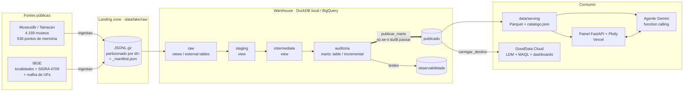
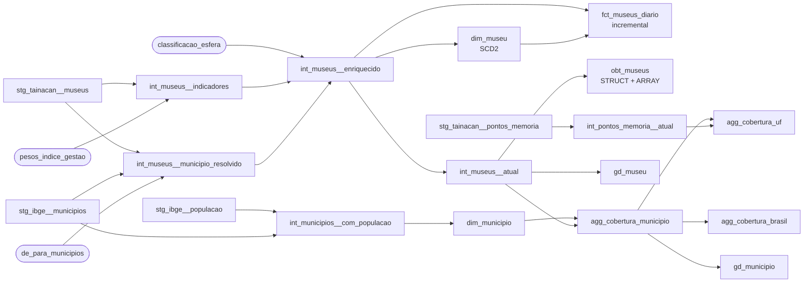
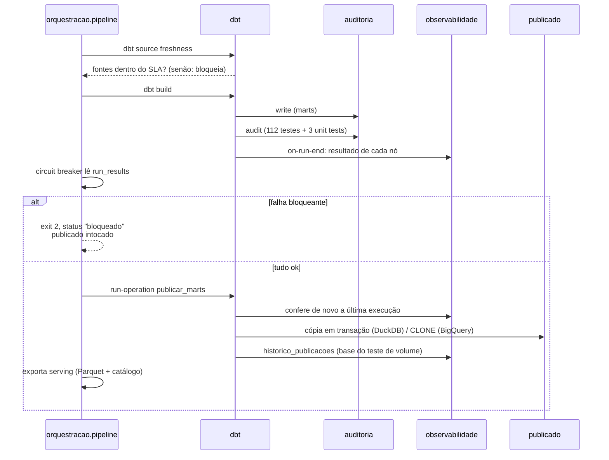
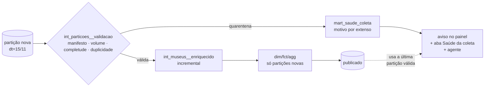

# Arquitetura

## Visão geral

## Camadas do dbt

Regras que o desenho garante:

- **Uma junção, um lugar.** `int_museus__enriquecido` é o único modelo que junta
  staging, indicadores, município e esfera. Todo mart lê dele. Se a regra de
  "museu ativo" mudar, muda num arquivo.
- **Razão calculada uma vez.** `museus_por_100k_hab`, `pct_*` nascem nos `agg_*`.
  Painel, agente e GoodData leem prontas ou refazem a mesma conta sobre as
  mesmas colunas (`docs/metricas.md`).
- **Nenhum consumidor lê `auditoria`.** A conexão do painel/agente só tem
  `publicado`; o GoodData só recebe `gd_*` de `publicado`.

## Write-Audit-Publish

O breaker existe em dois lugares de propósito: no orquestrador e dentro da
macro `publicar_marts`. Quem rodar o publish na mão também é barrado.

Testado de verdade: com o seed de pesos somando 101, o build falhou no teste
`soma_igual_a`, 60 nós a jusante não rodaram, o pipeline saiu com código 2 e
`data/serving` não foi tocado.

### O que é bloqueante

| teste | onde | por quê |
|---|---|---|
| `unico_por` museu × dt | staging, intermediate, fato | duplicata infla toda contagem |
| `reconcilia_com_manifest` | staging | perda silenciosa de linhas entre lake e warehouse |
| `cobertura_minima` município ≥ 99% | intermediate | abaixo disso os agregados territoriais mentem |
| `scd2_valida` | dim_museu | vigências sobrepostas duplicam o fato no join |
| `volume_estavel` (±10%) | marts publicados | extração parcial ou filtro quebrado |
| `no_intervalo` museus ativos ≥ 1000 | agg_cobertura_brasil | piso de sanidade |
| `soma_igual_a` 100 | seed de pesos | índice de gestão fora da escala |
| `relationships` | dim → dim_municipio, gd_museu → gd_municipio | fato órfão some do BI |

Avisos (não bloqueiam, aparecem na aba Qualidade): cobertura de coordenadas,
status fora da lista conhecida, partição com mais de 2 dias.

## Quando a coleta vem quebrada

A coleta de um dia é validada antes de entrar. Se falha, vai para quarentena
com o motivo; os marts continuam com a última coleta coerente e a publicação
acontece normalmente (status `sucesso_com_quarentena`). O breaker de 004 fica
para o que não é problema de coleta. Detalhes e testes em
[decisões/009](decisoes/009-quarentena-por-particao.md).

| modelo | incremental por | o que relê a cada build |
|---|---|---|
| `int_particoes__validacao` | fonte × dt | só partições novas + janela de 3 dias |
| `int_museus__enriquecido` | dt | só partições novas **e válidas** (pruning no lake) |
| `dim_museu` (SCD2) | museu_sk | partições novas + ~4 mil versões abertas |
| `fct_museus_diario` | dt | só partições novas |

## Incremental e reprocessamento

`fct_museus_diario` é incremental por partição `dt`:

- DuckDB: `delete+insert` com `unique_key = 'dt'`
- BigQuery: `insert_overwrite`, `partition_by dt`, `cluster_by [uf_sigla, municipio_id, museu_id]`, `require_partition_filter = true`

Cada execução reescreve as últimas `janela_reprocessamento_dias` (3) partições.
Rodar duas vezes o mesmo dia dá o mesmo resultado (o CI verifica). Correção
retroativa na origem entra sem full-refresh.

## Serving e Vercel

A Vercel roda funções sem disco persistente, então o painel não pode abrir o
warehouse. `orquestracao/serving.py` exporta `publicado` para Parquet (1,3 MB
no total) e um `catalogo.json` (descrições, colunas, linhagem, métricas,
testes). Esses arquivos vão no deploy. Em memória, `consumo/dados.py` monta as
tabelas no schema `publicado` e desliga acesso a arquivos e rede
(`enable_external_access = false`, `lock_configuration = true`).

Atualizar o painel = rodar o pipeline + commitar `data/serving` + deploy.
