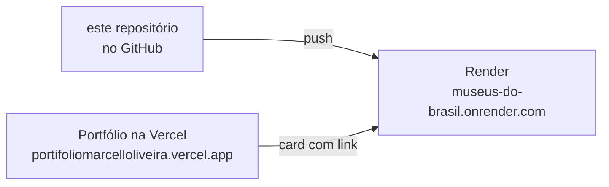

# Publicar o painel no Render e ligar no portfólio

O painel (FastAPI + Plotly + agente) sobe sozinho no Render a partir deste
repositório. O portfólio ([Pantercode/Portifolio2.0](https://github.com/Pantercode/Portifolio2.0))
continua como está e só ganha um card apontando para o app, igual ao projeto
"censo-escolar".



## 1. Render (uma vez, ~5 minutos)

1. Suba este repositório para o GitHub (com `data/serving/` junto: é o dado que o painel lê).
2. Em [dashboard.render.com](https://dashboard.render.com): **New → Blueprint** e escolha o repositório.
   O Render lê o [`render.yaml`](../render.yaml) e cria o serviço `museus-do-brasil` (plano free).
3. Quando ele pedir, preencha **`GEMINI_API_KEY`** (a chave do Google AI Studio).
4. Aguarde o build (~3 min). O endereço fica parecido com `https://museus-do-brasil.onrender.com`.
   Se o nome já existir no Render, ele acrescenta um sufixo; use o endereço que aparecer.

O que o Render roda:

| | |
|---|---|
| build | `pip install -r requirements.txt` (só o runtime: FastAPI, Plotly, DuckDB, Gemini) |
| start | `uvicorn painel.app:app --host 0.0.0.0 --port $PORT` |
| saúde | `GET /api/saude` |

Testado num ambiente limpo só com essas dependências: todas as páginas respondem 200.

**Plano free:** o serviço dorme após 15 minutos sem acesso; a primeira visita depois
disso demora uns 50 segundos. Para evitar, um monitor gratuito (UptimeRobot, cron-job.org)
pode chamar `/api/saude` a cada 10 minutos.

## 2. Atualizar os números

```bash
python -m orquestracao.pipeline        # coleta + dbt + publish + data/serving
git add data/serving && git commit -m "dados: atualização" && git push
```

O Render faz o deploy sozinho a cada push (`autoDeploy: true`).

## 3. Card no portfólio

No `assets/data.js` do portfólio, dentro de `projects: [ ... ]`, junto dos projetos
dbt, cole o bloco de [`docs/portfolio/projeto-museus.js`](portfolio/projeto-museus.js).
Troque a URL do Render se a sua for diferente.

O card usa os mesmos campos do "censo-escolar": `live: true` mostra o selo
"Publicado · no ar" e o link `primary` vira o botão principal.

### Opcional: abrir o painel dentro do portfólio

O painel aceita ser carregado num iframe. Para usar o mesmo visual de
"painel interativo" dos dashboards de Power BI, são duas mudanças pequenas no portfólio:

1. em `assets/app.js`, na função `embedHTML`, acrescente o rótulo do tipo novo:
   ```js
   const label = { powerbi: "Power BI · painel interativo", looker: "Looker Studio · painel interativo",
                   pdf: "Documento PDF", app: "App ao vivo · Python" }[e.type];
   ```
2. no bloco do projeto, descomente a linha `embed: { type: "app", url: ... }`.
